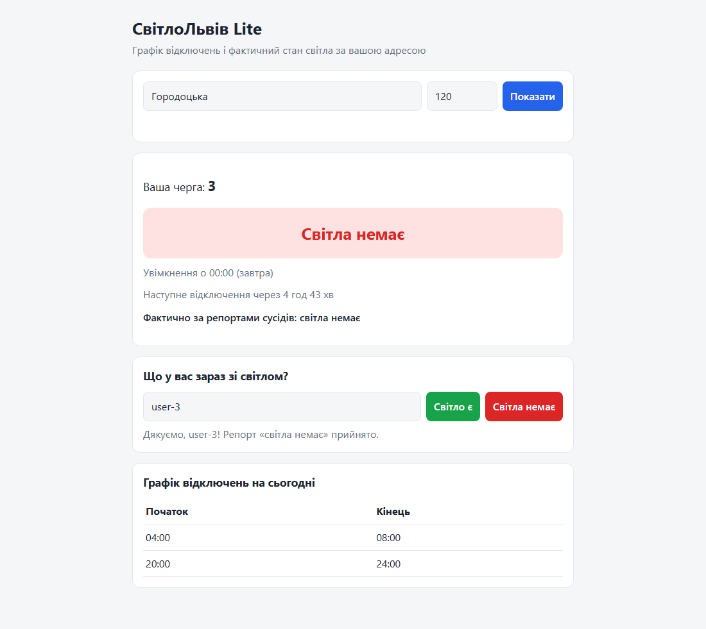
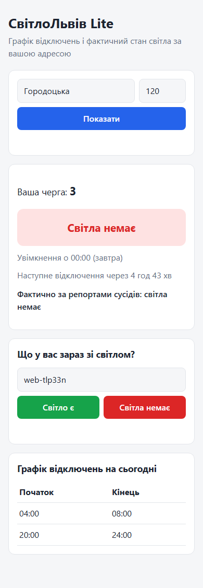

# Звіт про тестування — СвітлоЛьвів Lite v1.0

Дата прогону: 2026-10-13 · Python 3.12.1 · pytest 8, pytest-cov, Playwright (Chromium) · Windows 11

## Підсумок

| Вид тестів | Каталог | Кількість | Результат |
|---|---|---|---|
| Модульні | `tests/unit` | 70 | ✅ 70 passed |
| Інтеграційні (TestClient + тимчасова SQLite) | `tests/integration` | 28 | ✅ 28 passed |
| E2E (Playwright + uvicorn) | `tests/e2e` | 4 | ✅ 4 passed |
| **Разом** | | **102** | **✅ 102 passed, 0 failed** |

Покриття пакета `app` — **99 %** (331 інструкція, пропущено 1 — читання змінної середовища в `db.py`).
Ціль ≥ 70 % досягнута. Адаптер `bot/bot.py` (потребує Telegram-токена) не входить у покриття;
його логіка винесена в `bot/texts.py` і покрита на 94 %.

```
pytest tests/unit tests/integration --cov=app --cov-report=term-missing
Name                            Stmts   Miss  Cover   Missing
-------------------------------------------------------------
app\api\routes.py                  87      0   100%
app\db.py                          13      1    92%   16
app\main.py                        16      0   100%
app\models.py                      32      0   100%
app\seed.py                        18      0   100%
app\services\addresses.py          26      0   100%
app\services\notifications.py      22      0   100%
app\services\parser.py             28      0   100%
app\services\reports.py            29      0   100%
app\services\schedules.py          26      0   100%
app\services\status.py             34      0   100%
-------------------------------------------------------------
TOTAL                             331      1    99%
98 passed

pytest tests/e2e -v
test_address_shows_queue_and_schedule[chromium]            PASSED
test_unknown_address_shows_error[chromium]                 PASSED
test_three_reports_switch_actual_status_to_off[chromium]   PASSED
test_mobile_layout_has_no_horizontal_scroll[chromium]      PASSED
4 passed
```

## Що перевіряється

**Модульні** (сервіси — чисті функції, час передається через `now`):
- `parse_intervals` — звичайний графік, сортування, `;`, перетин опівночі, `24:00`, порожній рядок,
  6 видів некоректних рядків → `ScheduleParseError` (SVL-12);
- `find_queue` / `suggest_streets` — регістр, пробіли, префікс «вул.», ліміт 10 (SVL-10, SVL-11);
- `diff_schedules` / `import_schedule` — перший імпорт, повторний без змін, змінена черга 3,
  різне форматування не вважається зміною, некоректний графік не псує старий (SVL-14);
- `is_power_on` / `next_change` / `next_outage` — світло є, світла немає, межі інтервалу,
  відключення завтра, перетин опівночі, злиття суміжних інтервалів, без відключень (SVL-15, SVL-16);
- `due_notifications` — точно за N хв, вікно ±2 хв, поза вікном, різні N, черга без відключень (SVL-17);
- тихі години — межі 23:00/07:00, фільтрація вночі, без тихих годин, вдень (SVL-18);
- `add_report` / `actual_status` — збереження, менше порогу, поріг 3, старі репорти (> 30 хв),
  інші вулиці, один голос на користувача, конфлікт статусів (SVL-19, SVL-20);
- антиспам — повтор за 9 хв → `RateLimitError`, через 10 хв дозволено, ліміт на користувача+адресу (SVL-21).

**Інтеграційні**: `/queue` (200/404), `/streets`, імпорт графіка → `changed_queues`,
`/schedule/{queue}`, `/status` (planned, next_change, next_outage, minutes_to_outage, actual),
підписки та `/notifications/due` з тихими годинами, `/reports` (201/404/422/429), сторінка `/`;
наскрізний сценарій «імпорт → статус → імпорт зміненого графіка → статус змінився» і збереження
даних між екземплярами застосунку (SVL-26).

**E2E** (SVL-27): Playwright запускає uvicorn з тимчасовою БД, відкриває `/`, вводить адресу,
перевіряє чергу та графік, тричі натискає «Світла немає» від різних `user_id` і перевіряє,
що фактичний стан став «світла немає»; помилка для невідомої адреси; відсутність горизонтального
скролу на ширині 375 px.

## Скріншоти

| Десктоп (після трьох репортів) | Мобільний (390 px) |
|---|---|
|  |  |

## Стандарт коду

`ruff check .` — без помилок, `black --check .` — без змін.
